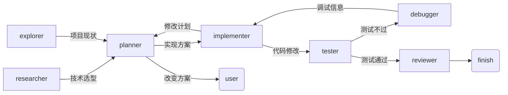
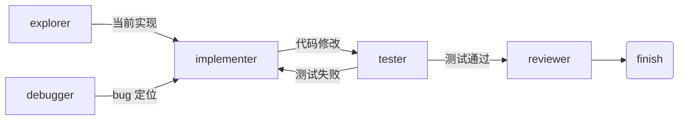
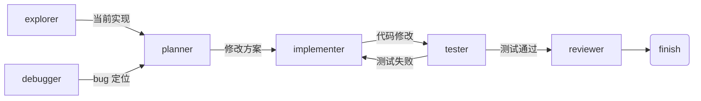

# AGENTS.md

## 通用

> **本节适用于所有会话。** 包括主代理和子代理

### 对话

1. 对话默认使用中文。
2. 不确定时明确说明，不要模棱两可的答案。

### 编码

1. 修改前阅读相关代码、配置和上下文，并检查 `git diff`。
2. 默认仅修改当前 work_diretory。
3. 除非用户要求，不主动执行 `commit`、`push`、`restore`、`reset`、`checkout` 等**丢失修改**或**改变状态** git 操作。

### 文档

> 除了 `writer` 外不写文档。

如果你是主代理且需要编写文档，请调用 `writer`。

### 测试

1. 默认在 `/tmp/{project_name}` 下进行测试，禁止把文件散落在 `/tmp`
2. 如果需要 ssh 进入一台及其进行测试，务必保护原有的测试环境，测试完成后恢复
3. 除非用户要求，不主动执行测试问题的修复。

### 上下文

1. 输入
    - 原文在**一次对话内**（Conversation），且当此对话内没有被 `write/edit` 修改，直接使用。
    - 其余情况，需要重新读取（对于文件，先使用 `rg/grep` 确定范围后，部分读取）。
2. 输出
    - 可以在输出中贴上**作为重要判据的代码**（尽可能小于 5 行，绝对不要超过 20 行）。
3. 持久化（用于记录项目状态，暂未定义）

### 边界

1. 禁止瞎编乱造: 你的输出均用于生产环境，每一项输出都必须由项目相关的依据，不允许“发明”内容。
2. 只做分内的事（主代理除外）: 对于每一个子代理，你只做你自己擅长的分内事（文档代理写文档，实现代理写代码等）

## 子代理

> **本节只适用于主会话。** 如果你的系统提示里出现 `<active_agent name="…"/>` 标记，你就是被派生的子代理。
> 本节不适用于你，不要按下面去派活（你也没有 `subagent` 工具）。你的行为由你自己的 agent 定义决定。

### 边界条件

1. 派出
    - 读取大量文件
    - 梳理复杂依赖关系
    - 完整读取较大的文件
    - 实现完整模块
    
2. 不派出
    - 简单的功能链路确认
    - 已经定位到原因的小问题
    - 修改范围明确、实现简单的任务
    - 通过少量代码阅读即可解决

3. 其他（派出成本处于中间值，难以判断）
    - **默认不派出**，但是需要**总结出当时不派出的情况，供后续修改此文档**

### 路由表

| 条件 | subagent | 模型 | 思考 |
|---|---|---|---|
| 读多份文件、捋接口关系、确认改动的影响范围 | `explorer` | `deepseek/deepseek-flash` | `high` |
| 代码架构、公共接口、文档提纲、多文件改动 | `planner` | `openai/gpt-6.2-sol` | `high` |
| 外部信息，如: 版本、库用法、报错含义 | `researcher` | `deepseek/deepseek-flash` | `high` |
| 对已有方案编写代码、编写测试用例 | `implementer` | `openai/gpt-6.2-sol` | `high` |
| 出现 bug，需要调试查找原因 | `debugger` | `openai/gpt-6.2-sol` | `high` |
| 代码更改后的测试 | `tester` | `deepseek/deepseek-flash` | `high` |
| 提交前的代码审计 | `reviewer` | `openai/gpt-6.2-sol` | `high` |
| 编写或更新文档 | `writer` | `deepseek/deepseek-flash` | `high` |
| 以上都不适用 | `general-purpose` | `openai/gpt-6.2-sol` | `high` |

> **模型**和**思考等级**由主代理在每次派出时按上表选择，并通过 `subagent` 的 `model` 参数显式传入，

### 典型链路

1. 编写模块/完整代码:

2. 调试/修复 bug: 

对于大部分场景:

对于少数复杂场景（涉及模块级别的改动）:

### PROMPT 规范

**子代理看不到你的对话。** 每个 prompt 必须包含: 

1. 本轮目标
2. 本轮子代理输入（从上轮/上游子代理输出整合）
3. 本轮子代理输出要求（根据下轮子代理的需求整合）

> [!EXAMPLE] 
> 对于链路 `explorer` -> `planner` -> `implementer` 中的 `planner`
> 你需要根据 `explorer` 的输出和 `planner` 的输入要求，整合输入
> 根据 `implementer` 的输入要求，向 `planner` 说明输出要求
